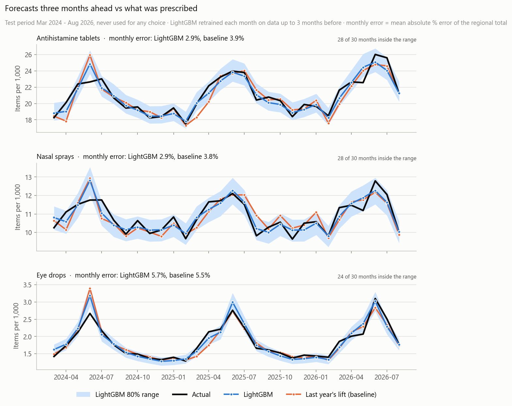
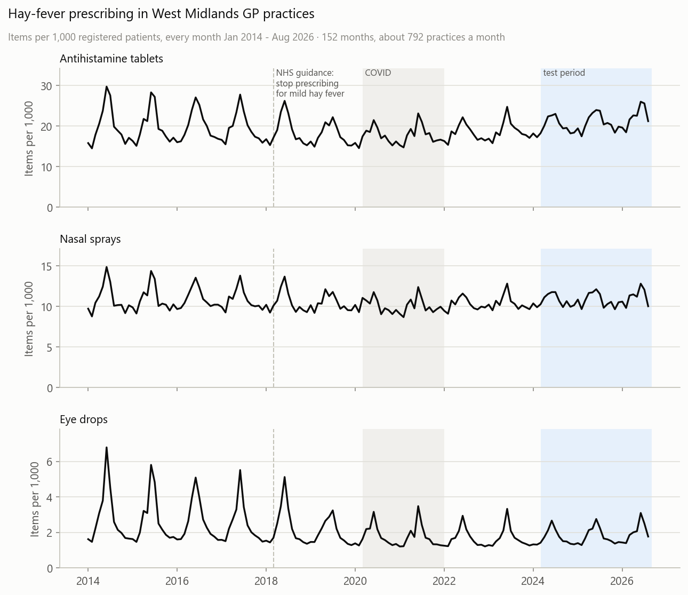
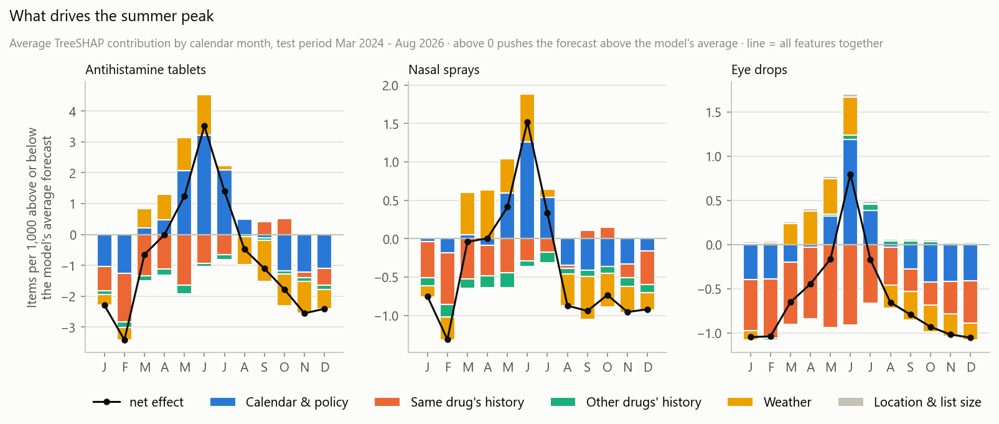

# Hay Fever Prescribing Forecast

[](https://github.com/MSyukri420/HayFever_Forecast/actions/workflows/tests.yml)

**How many hay-fever prescriptions will GP practices write three months from now?** A monthly forecast for every GP practice in the West Midlands, built on 12 years of NHS open data: 120,429 practice-months from 936 practices, with local weather.

It covers antihistamine tablets, nasal sprays and eye drops. For each practice it forecasts items per 1,000 patients three months ahead, using only data that would have been published by then. Each forecast comes with an 80% range and the three things that drive it most, and an API serves the latest forecast (Sep–Nov 2026). It was tested on 30 months it never saw, Mar 2024 to Aug 2026.



## Key findings

- **The summer peak has halved since NHS guidance in 2018.** NHS England told GPs to stop prescribing for mild hay fever, and the drop shows from 2019. In June, antihistamine prescribing used to rise 12.0 items per 1,000 patients above its winter level (2014–18). In 2019–25 the rise averaged 6.3.
- **Year-round antihistamine use is rising.** The Jan–Feb rate went from 15.0 per 1,000 in 2021 to 19.1 in 2026 (+27%). The 2025 yearly total (250 per 1,000) was above 2014's (239), even with the smaller summer peak.
- **The season itself drives the June peak.** For tablets, the June forecast sits 3.5 items per 1,000 above the model's average, and the calendar month adds 3.2 of that and the weather of the months before adds 1.3. June's own weather isn't known in time.
- **Eye drops are the most seasonal and the hardest to forecast.** In June they still reach about twice their winter rate, against about 1.3× for tablets. On the test, no model beats the simple baseline for them.

## Highlights

- **Honest evaluation.** A leakage test checks that every feature only uses data published three months before the forecast month. No choice was made on the test months. For antihistamines, the monthly error of the regional total is 2.9%, against 3.9% for the best baseline. The 95% range for that gap is 0.3 to 1.9 points, so the gain isn't luck in the test months.
- **Ranges that hold.** The 80% ranges contained 81–82% of the actual practice values in the test, for small and large practices alike.
- **Run as it would be used.** DuckDB SQL builds the table, the model is retrained every month on the data available at that point, and a FastAPI service in Docker serves the forecasts, with tests run by GitHub Actions on every push. Monthly retraining cut the under-forecast for antihistamines from −1.5% to −0.6%.
- **Monitored like a service.** A control (SPC) chart of the monthly error flags drift: tablets and sprays show none, while eye drops were under-forecast 7 months running, Sep 2025 to Mar 2026. It sits in a four-page Power BI report built on a star schema from DuckDB SQL.
- **Improved after finding a flaw in my own work.** The first version chose its model on 2023 alone. I later measured that one year's score moves by 0.7–0.9 points by chance, more than the gaps between the models. So model choice now uses three years, and an idea is kept only if it wins in every year. Five ideas tried since were all rejected. That includes an Optuna tuning gain that turned out to come from one lucky random seed. See [Version history](docs/technical.md#version-history).

**Tech stack:** Python, DuckDB (SQL), pandas, LightGBM, PyTorch, SHAP (TreeSHAP), Optuna, FastAPI, Docker, GitHub Actions, Power BI (DAX), matplotlib, pytest. Data comes from the NHSBSA, NHS Digital, Open-Meteo and postcodes.io APIs.

## Results

| Drug group | LightGBM | PyTorch | Best baseline | LightGBM vs baseline (95% range) |
|---|---|---|---|---|
| Antihistamine tablets | 2.9% | 3.3% | 3.9% | 25% lower (8–42%) |
| Nasal sprays | 2.9% | 3.4% | 3.8% | 24% lower (11–37%) |
| Eye drops | 5.7% | 6.5% | 5.5% | level (−19% to +36%) |

Monthly error of the West Midlands total on the test, Mar 2024 to Aug 2026. The baseline is last year's seasonal rise added to this year's winter level. The PyTorch network matches LightGBM practice by practice, but it misses the regional total by more.

<p>
  
  
</p>

## Power BI report


Four pages: trends, practices, the next 3 months with ranges and SHAP drivers, and this model check. The model and its DAX measures are saved as text, so they diff in git like code. Screenshots of every page and the measures are in [docs/powerbi.md](docs/powerbi.md).

## Run it

```bash
pip install -r requirements.txt
python -m src.run_all                  # download the data, build the table and features
python -m src.model --target antihist  # validate, choose and test (also: nasal, eye)
python -m src.forecast                 # train on all the data, forecast the next 3 months
uvicorn src.api:app                    # API docs at http://127.0.0.1:8000/docs
```

The first run downloads about 50 MB from public APIs and takes about 15 minutes; after that the data is cached. `GET /practices/M81001/forecast?group=antihist` returns three months, each with its range and top drivers. `docker build -t hayfever-api .` packs the API into an image. More commands are in [docs/technical.md](docs/technical.md#running-and-retraining).

## Data

[NHSBSA English Prescribing Dataset](https://opendata.nhsbsa.net/dataset/english-prescribing-data-epd) and NHS Digital [patients registered at a GP practice](https://digital.nhs.uk/data-and-information/publications/statistical/patients-registered-at-a-gp-practice), Jan 2014 – Aug 2026. Both are under the [Open Government Licence](https://www.nationalarchives.gov.uk/doc/open-government-licence/version/3/). Weather is from the [Open-Meteo](https://open-meteo.com/en/docs/historical-weather-api) ERA5 archive ([CC BY 4.0](https://creativecommons.org/licenses/by/4.0/)).

## Limitations

- **Prescriptions, not hay fever**: most hay-fever treatment is now bought over the counter and doesn't appear here.
- **No pollen data**: weather stands in for pollen, and June's own weather isn't known 3 months ahead.
- **One region**: West Midlands only, 936 practices.
- **Cautious regional range**: 93% of test months fell inside the 80% range for tablets and sprays.

**Next steps** that would improve it: all-England data (about 6,000 practices), pharmacy access and deprivation by neighbourhood, and a long pollen-count series if one becomes openly available.

Method, evaluation, ideas tried, project layout and version history: [docs/technical.md](docs/technical.md). Power BI report: [docs/powerbi.md](docs/powerbi.md)
