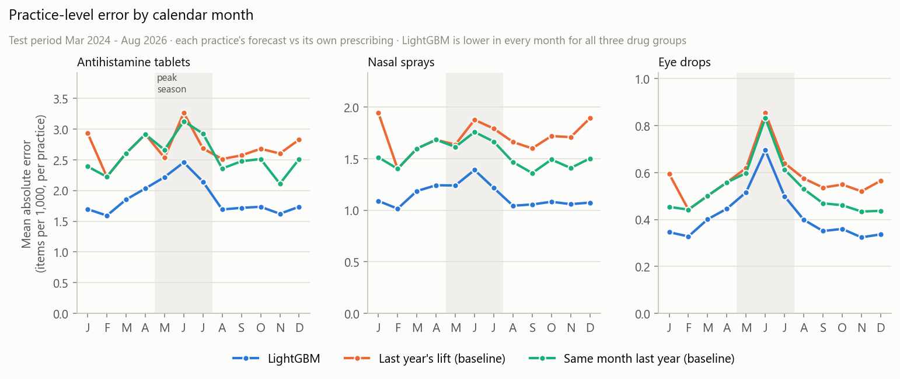

# Hay Fever Prescribing Forecast

**How many hay-fever prescriptions will GP practices write three months from now?** A monthly forecast for every GP practice in the West Midlands, built on 12 years of NHS open data: 120,429 practice-months from 936 practices, with local weather.

It covers antihistamine tablets, nasal sprays and eye drops. For each practice it forecasts items per 1,000 patients three months ahead, using only data that would have been published by then. It was tested on 30 months it never saw, Mar 2024 to Aug 2026.


## Key findings

- **The summer peak has halved since NHS guidance in 2018.** NHS England told GPs to stop prescribing for mild hay fever, and the drop shows from 2019. In June, antihistamine prescribing used to rise 12.0 items per 1,000 patients above its winter level (2014–18). In 2019–25 the rise averaged 6.3.
- **Year-round antihistamine use is rising.** The Jan–Feb rate went from 15.0 per 1,000 in 2021 to 19.1 in 2026 (+27%). The 2025 yearly total (250 per 1,000) was above 2014's (239), even with the smaller summer peak.
- **Eye drops are the most seasonal and the hardest to forecast.** In June they still reach about twice their winter rate, against about 1.3× for tablets. On the test they are the one group where the model doesn't beat the simple baseline.
- **Small practices are much harder to forecast.** For antihistamines, practice-level error in the smallest quarter of practices is nearly twice that in the largest (2.5 vs 1.3 items per 1,000). A few patients more or less moves a small practice's rate a lot.

## Highlights

- **Honest evaluation.** Every feature is checked by a leakage test, so it only uses data published three months before the forecast month. No choice was made on the test months. For antihistamines, the monthly error of the regional total is 2.9%, against 3.9% for the best baseline: about a quarter lower.
- **Run as it would be used.** The model is retrained every month on the data available at that point. A model frozen at the end of 2023 drifted low as prescribing kept rising. Monthly retraining cut that bias for antihistamines from −1.5% to −0.6%.
- **Improved after finding a flaw in my own work.** The first version chose its model on 2023 alone. I later measured that one year's score moves by 0.7–0.9 points by chance, more than the gaps between the models. So model choice now uses three years, and an idea is kept only if it wins in every year. Five ideas tried since were all rejected. That includes an Optuna tuning gain that turned out to come from one lucky random seed. See [Version history](docs/technical.md#version-history).

**Tech stack:** Python, pandas, NumPy, LightGBM, Optuna, matplotlib, pytest. Data comes from the NHSBSA, NHS Digital, Open-Meteo and postcodes.io APIs.

## Results

| Drug group | LightGBM | Best baseline | Difference |
|---|---|---|---|
| Antihistamine tablets | 2.9% | 3.9% | about a quarter lower |
| Nasal sprays | 2.9% | 3.8% | about a quarter lower |
| Eye drops | 5.7% | 5.5% | level with the baseline |

Monthly error of the West Midlands total on the test, Mar 2024 to Aug 2026. The baseline is last year's seasonal rise added to this year's winter level.

<p>
  
  
</p>

## Run it

```bash
pip install -r requirements.txt
python -m src.run_all                  # download the data, build the table and features
python -m src.model --target antihist  # train, validate and test (also: nasal, eye)
python -m src.graph                    # charts into docs/figures/
```

The first run downloads about 50 MB from public APIs and takes about 15 minutes; after that the data is cached. More options are in [docs/technical.md](docs/technical.md#running-and-retraining).

## Data

[NHSBSA English Prescribing Dataset](https://opendata.nhsbsa.net/dataset/english-prescribing-data-epd) and NHS Digital [patients registered at a GP practice](https://digital.nhs.uk/data-and-information/publications/statistical/patients-registered-at-a-gp-practice), Jan 2014 – Aug 2026. Both are under the [Open Government Licence](https://www.nationalarchives.gov.uk/doc/open-government-licence/version/3/). Weather is from the [Open-Meteo](https://open-meteo.com/en/docs/historical-weather-api) ERA5 archive ([CC BY 4.0](https://creativecommons.org/licenses/by/4.0/)).

## Limitations

- **Prescriptions, not hay fever**: most hay-fever treatment is now bought over the counter and doesn't appear here.
- **No pollen data**: weather stands in for pollen, and June follows June's own weather, which isn't known 3 months ahead.
- **One region**: West Midlands only, 936 practices.
- **Point forecasts**: no prediction intervals yet.

**Next steps** that would improve it: all-England data (about 6,000 practices), prediction intervals, and a long pollen-count series if one becomes openly available.

Method, evaluation, ideas tried, project layout and version history: [docs/technical.md](docs/technical.md)
