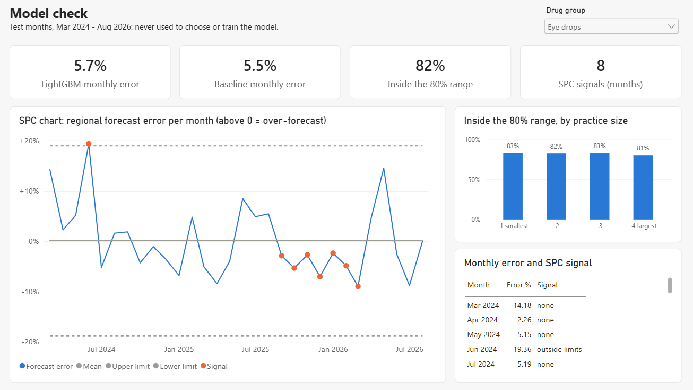
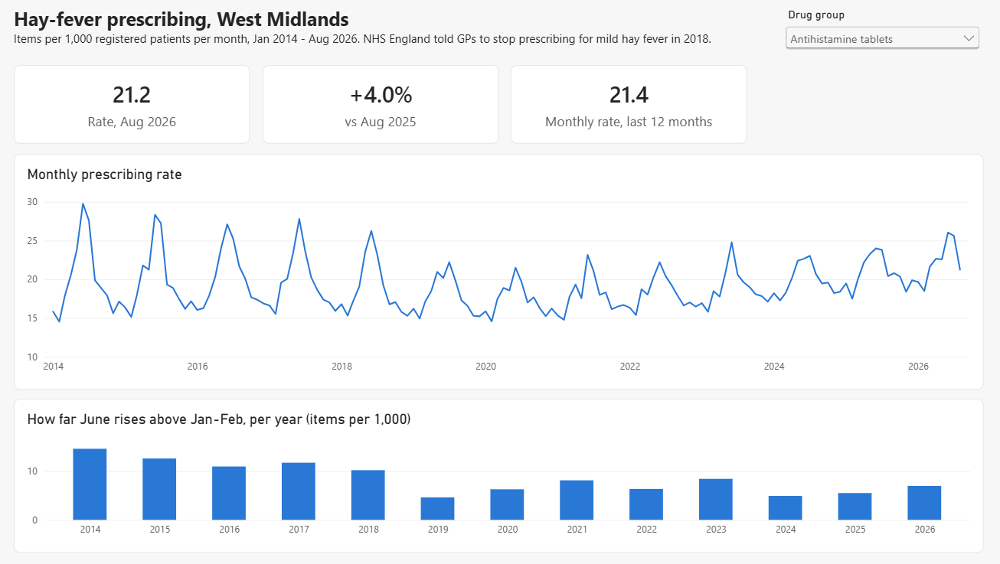
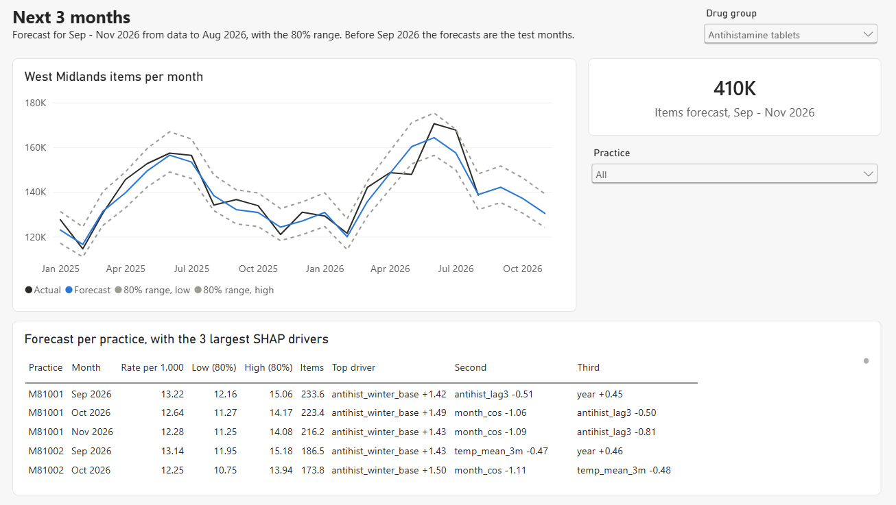
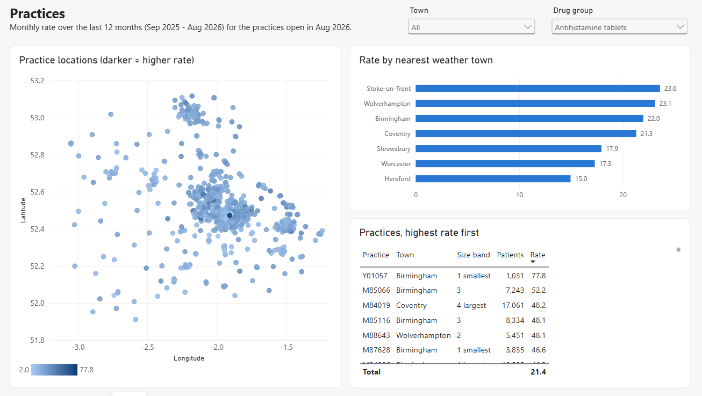

← [Back to README](../README.md)

# Hay Fever Prescribing Forecast: Power BI report

A four-page Power BI report: prescribing trends, practices, next quarter's forecast, and a model check with an SPC chart of the forecast error. It is saved as a Power BI Project ([`powerbi/HayFever.pbip`](../powerbi/HayFever.pbip)). The model is in TMDL and the report pages are in PBIR, both plain text, so the DAX and every visual can be reviewed in git like code.



## Open it

```bash
python -m src.powerbi    # the star schema in output/powerbi/ (after src.model for all three groups and src.forecast)
```

Open `powerbi/HayFever.pbip` in Power BI Desktop and select **Refresh**. A project holds no data, so the first refresh loads the CSVs. If the repo isn't at `D:\Github Repo\HayFever_Forecast`, first set the `DataFolder` parameter to your `output/powerbi` folder (**Transform data → Edit parameters**). Edits made in Desktop are saved back to the same files.

## Pages

A drug-group slicer sits at the top right of every page, synced across pages. It opens on antihistamine tablets.

| Page | Shows |
|---|---|
| **Trends** | The rate per 1,000 patients for the latest month, its change on a year earlier, and the last 12 months; the monthly rate since 2014; how far June rises above Jan–Feb each year, which halves after the 2018 NHS guidance |
| **Practices** | Practice locations shaded by rate, the rate by nearest weather town, and practices ranked by rate, for the last 12 months; slicer by town |
| **Next 3 months** | West Midlands items per month from 2025, actual against forecast with the 80% range, through Sep–Nov 2026; items forecast for the quarter; the forecast per practice with its range and 3 largest SHAP drivers; slicer by practice |
| **Model check** | Test-month monthly error against the baseline, share of practice values inside the 80% range (overall and by practice size), and the SPC chart with signal months marked in orange |

<p>
  
  
</p>



## Tables

| Table | Rows | Grain | Columns |
|---|---|---|---|
| `dim_practice` | 936 | practice | practice_code, postcode, town, lat, lon, patients_latest, size_band (quartile of list size), first_month, last_month, active |
| `dim_month` | 155 | month | year_month, month_start, year, month, month_name, peak_season (May–Jul), period (history / test / forecast) |
| `dim_group` | 3 | drug group | drug_group, label, bnf_code |
| `fact_prescribing` | 361,287 | practice × month × group | items, patients, per1000 (Jan 2014 – Aug 2026) |
| `fact_test_forecast` | 64,800 | practice × month × group | actual, lightgbm, lower, upper (80% range), pytorch, last_year_lift, last_year, inside_range, abs_error (Mar 2024 – Aug 2026, rates per 1,000) |
| `fact_future_forecast` | 6,453 | practice × month × group | patients, forecast, lower, upper, items, driver_1–3 (Sep–Nov 2026) |
| `fact_regional` | 465 | month × group | actual_items, patients, forecast_items, forecast_lower, forecast_upper (West Midlands totals) |
| `fact_error_spc` | 90 | month × group | error_pct, moving_range, mean, upper_limit, lower_limit, signal (test months) |

## Model

- **Star schema.** Each fact table joins to `dim_practice` on practice_code (where it has one), to `dim_month` on year_month and to `dim_group` on drug_group. All joins are one-to-many, filtering from the dimension.
- **Date table.** `dim_month` is marked as the date table on `month_start`. Auto date/time is off, and `month_name` sorts by `month`.
- **Measures only.** Implicit measures are off, so every number in the report comes from a named measure in the `_Measures` table, and the fact keys are hidden.

## Measures

All are in [`_Measures.tmdl`](../powerbi/HayFever.SemanticModel/definition/tables/_Measures.tmdl). The main ones:

```dax
Items = SUM ( fact_prescribing[items] )

// each practice-month appears once per drug group, so divide out the groups in context
Patients = DIVIDE ( SUM ( fact_prescribing[patients] ), DISTINCTCOUNT ( fact_prescribing[drug_group] ) )

Rate per 1,000 = DIVIDE ( [Items], [Patients] ) * 1000

Rate, last 12 months =
VAR m = [Latest month]
RETURN
    CALCULATE ( [Rate per 1,000], REMOVEFILTERS ( dim_month ), dim_month[year_month] > m - 100 )

June rise over winter =
CALCULATE ( [Rate per 1,000], dim_month[month] = 6 )
    - CALCULATE ( [Rate per 1,000], dim_month[month] IN { 1, 2 } )

// test months: practice rates back to items, so totals add up across practices
Forecast items (test) = SUMX ( fact_test_forecast, fact_test_forecast[lightgbm] * fact_test_forecast[patients] / 1000 )

// the README's headline metric: average monthly error of the regional total
Monthly error =
AVERAGEX (
    VALUES ( fact_test_forecast[year_month] ),
    DIVIDE ( ABS ( [Forecast items (test)] - [Actual items (test)] ), [Actual items (test)] )
)

Inside 80% range =
DIVIDE (
    CALCULATE ( COUNTROWS ( fact_test_forecast ), fact_test_forecast[inside_range] = TRUE () ),
    COUNTROWS ( fact_test_forecast )
)

// the SPC lines only mean something for one drug group at a time
Forecast error = IF ( HASONEVALUE ( dim_group[drug_group] ), SUM ( fact_error_spc[error_pct] ) / 100 )
```

The measures were checked against the repo's results by querying the open model:

| Measure | Antihistamine tablets | Nasal sprays | Eye drops |
|---|---|---|---|
| `Monthly error` | 2.9% | 2.9% | 5.7% |
| `Baseline monthly error` | 3.9% | 3.8% | 5.5% |
| `Inside 80% range` | 81% | 81% | 82% |
| `SPC signals` | 0 | 0 | 8 |

## How to read the SPC chart

It is an XmR (individuals) control chart of the monthly error of the regional forecast on the 30 test months, built in SQL in [`src/powerbi.py`](../src/powerbi.py). The centre line is the mean error, and the limits are the mean ± 2.66 × the average month-to-month change (moving range). A month outside the limits, or a run of 7 or more months on one side of the mean, means something changed and is worth a look. Inside that, the error is ordinary month-to-month noise.

- **Antihistamine tablets and nasal sprays: no signals.** The mean error is −0.5% for tablets and −0.1% for sprays, so the forecast is close to unbiased. Every month's miss sits between −6% and +10%, well inside limits of about ±13%.
- **Eye drops: two signals.** June 2024 was over-forecast by 19%, just above the upper limit. And from Sep 2025 to Mar 2026 the forecast was under every month (7 in a row), so eye-drop prescribing rose that winter faster than the model expected. A team using this forecast would review the eye-drop model when a run like that starts, rather than wait for the yearly check.

The numbers come from `output/powerbi/fact_error_spc.csv` and change when the models are retrained.
